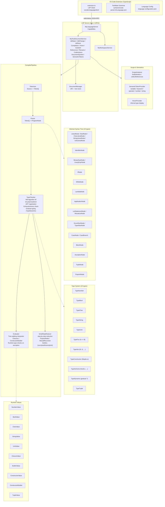
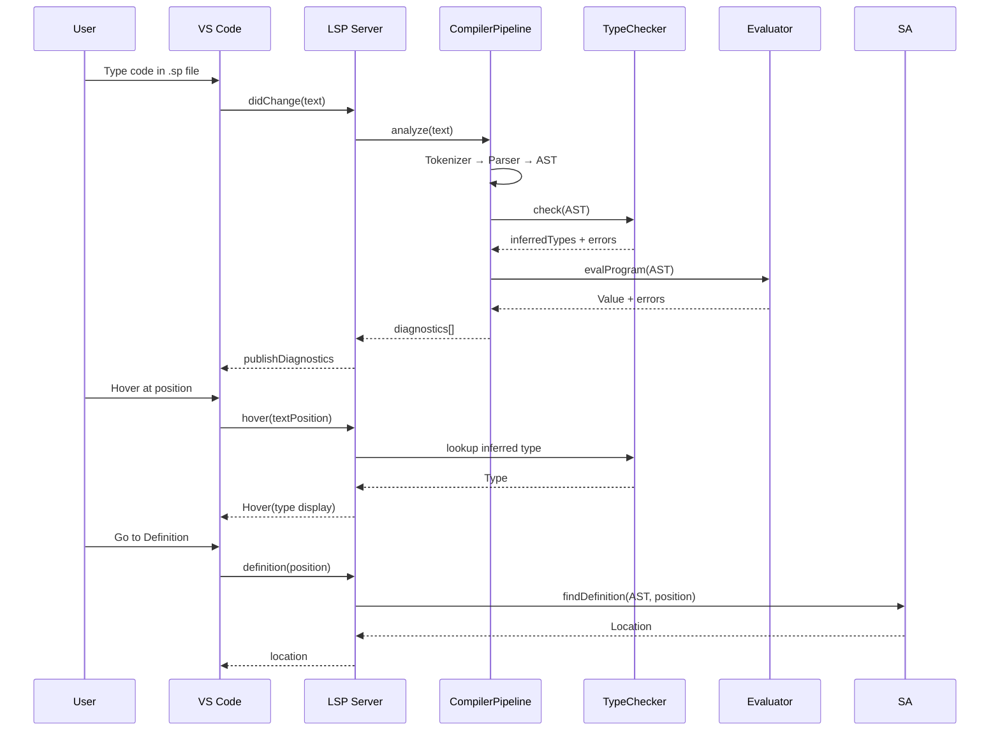
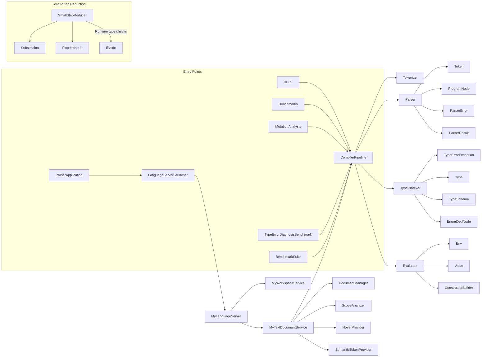

# Architecture — Scala Parser Language Server

## Overview



## Data Flow



## Component Dependencies



## Package Structure

```
scala.parser
├── ParserApplication.java              -- LSP entry point
├── REPL.java                           -- Interactive REPL
├── Benchmarks.java                     -- Performance benchmarks
├── MutationAnalysis.java               -- 12-op mutation analysis (37.2% detection)
├── TypeErrorDiagnosisBenchmark.java    -- 18 curated type-error programs
├── BenchmarkSuite.java                 -- 8 analysis modules (mutation matrix, scalability, error recovery, coverage, step-distribution, parser recovery, empirical matrix, runtime-breakdown); CLI: --runs N, --csv
├── core
│   ├── ParserError.java                -- Error record (message, line, col, length)
│   ├── ParserResult.java               -- AST + error list container
│   ├── ast/                            -- 23 AST node types (incl. WhileNode, CharLiteralNode, FixpointNode, TupleNode, MutualLetNode)
│   ├── lexer/                          -- Tokenizer + Token + TokenType (WHILE, CHAR, PACKAGE, IMPORT, SEALED, DOT, AT)
│   ├── parser/                         -- Recursive-descent Parser (while, char, multi-param, package/import/sealed/annotation ignoring)
│   ├── types/                          -- 10 type kinds + HM TypeChecker + TypeErrorException (incl. TypeChar, TypeDynamic)
│   ├── interpreter/                    -- Evaluator + 10 Value types + Env (incl. CharValue, TupleValue)
│   ├── reduction/                      -- SmallStepReducer + Substitution (step, reduce, beta-reduction, let-substitution)
│   ├── semantic/                       -- ScopeAnalyzer + SemanticTokenProvider
│   └── hover/                          -- HoverProvider
├── test/java/scala/parser/core/reduction/
│   ├── SmallStepPBT.java               -- 26 PBT properties (TypeDynamic, FixpointNode, TypeAliasNode, EnumDeclNode in generators; containsTypeDynamic/containsFixpoint guards)
│   ├── CoverageGuidedPBT.java          -- 8 targeted properties for hard-to-detect mutations (swap, let, undefined, inkl. chained/complex)
│   └── TypeSoundnessFormalTest.java    -- ~60+ formal tests (builtins, gradual typing, regression)
└── lsp/                                -- LSP4J implementations
    ├── LanguageServerLauncher.java
    ├── MyLanguageServer.java
    ├── MyTextDocumentService.java
    ├── MyWorkspaceService.java
    ├── DocumentManager.java
    └── CompilerPipeline.java
```
