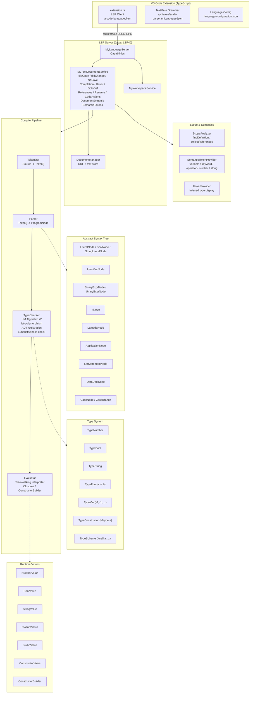
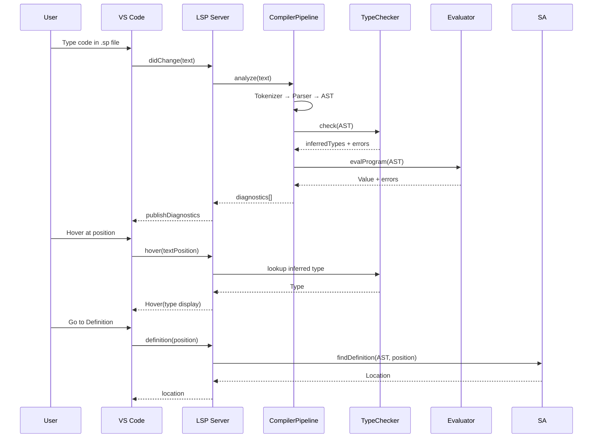
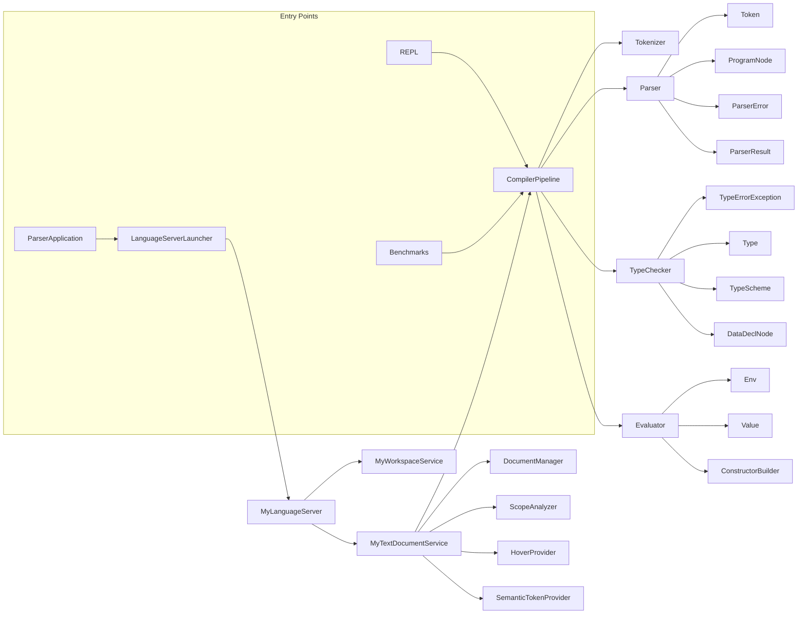

# Architecture — Scala Parser Language Server

## Overview



## Data Flow



## Component Dependencies



## Package Structure

```
scala.parser
├── ParserApplication.java       -- LSP entry point
├── REPL.java                    -- Interactive REPL
├── Benchmarks.java              -- Performance benchmarks
├── core
│   ├── ParserError.java         -- Error record (message, line, col, length)
│   ├── ParserResult.java        -- AST + error list container
│   ├── ast/                     -- 16 AST node types
│   ├── lexer/                   -- Tokenizer + Token + TokenType
│   ├── parser/                  -- Recursive-descent Parser
│   ├── types/                   -- Type hierarchy + TypeChecker + TypeErrorException
│   ├── interpreter/             -- Evaluator + Values + Env
│   └── semantic/                -- ScopeAnalyzer + SemanticTokenProvider
│   └── hover/                   -- HoverProvider
└── lsp/                         -- LSP4J implementations
    ├── LanguageServerLauncher.java
    ├── MyLanguageServer.java
    ├── MyTextDocumentService.java
    ├── MyWorkspaceService.java
    ├── DocumentManager.java
    └── CompilerPipeline.java
```
